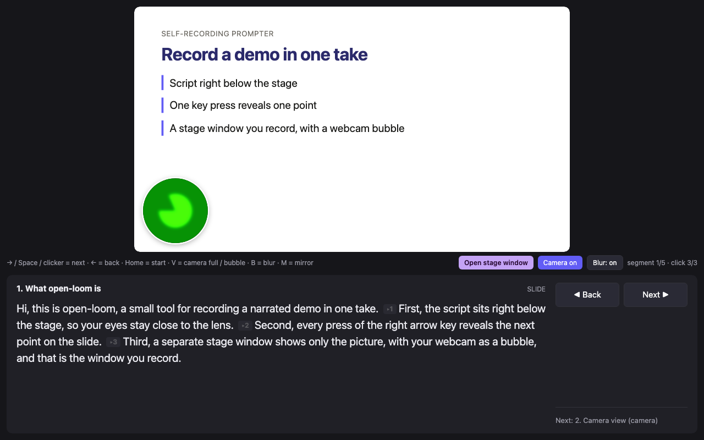

# open-loom

A free, local alternative to Loom for narrated demo videos. It is a teleprompter, a clean "stage" window you record, a webcam bubble with background blur, and a live demo page, in two browser windows (the script page and the stage window). Nothing is uploaded anywhere.



## How it works

- The **script page** shows a 16:9 stage on top and your script below it, with a marker (▸1, ▸2, ...) at every point where the slide reveals the next item.
- **Open stage window** opens a second, small window that shows only the stage and follows the script page. It is a popup and still has an address bar, so use Chrome's window capture (not a region) and record that window.
- Your webcam shows as a round bubble on slides and live-demo segments, and full frame on camera segments. Background blur, framing and light correction run in the browser.
- A **screen** segment shows a live page (an iframe). What you click in the script page's demo shows up on the stage window.

## Quick start

```
python3 build.py examples/hello
python3 -m http.server -d examples/hello/dist 8000
```

Open http://localhost:8000/prompter.html in Chrome or Edge and click "Turn camera on". Python 3 only, no packages.

## Recording workflow

1. Open the script page, turn the camera on, click **Open stage window**.
2. In the stage window, if the project has a live demo, click the purple button once (it shows while a screen segment is on stage, so it is never recorded on slides) and pick the Chrome tab titled `<project title> [script]`. The stage window is titled `[stage] record this window`. This mirrors the live demo into the stage.
3. Start a recorder on the stage window: macOS `Cmd+Shift+5` ("Record Selected Portion" or the window), or OBS window capture. Choose your microphone in the recorder.
4. Click the script page and speak. Press the right arrow (or use a clicker) to move on. Stop the recorder at the end.

## Keys

| Key | Action |
| --- | --- |
| `→`, `Space`, `PageDown`, `↓` | Next step (reveal, then next segment) |
| `←`, `PageUp`, `↑` | Back |
| `Home` | Back to the start |
| `V` | Camera full frame or round bubble |
| `B` | Background blur on or off |
| `M` | Mirror the camera |

## Project format

A project is a folder:

```
my-video/
  project.json    {"title": "My video", "demo_url": "demo.html"}
  segments.json   [{"id": "intro", "title": "Intro", "view": "slide", "say": "...", "cue": "optional"}]
  slides.html     <section class="view slide" id="v-intro"> ... </section>
  slides.css      optional, the look of your slides
```

- `view` is `slide`, `camera` (webcam full frame) or `screen` (live demo iframe, needs `demo_url`). `cue` is a hint shown above the buttons on screen segments.
- A slide segment needs a section `id="v-<segment id>"` with classes `view slide`.
- Reveal elements: `class="rv" data-at="exact phrase from the say text"`. The build finds the phrase (first occurrence, case-sensitive) and writes `data-f`. Each distinct reveal position is one click step, so give each `data-at` its own phrase, written with double quotes, on an element with class `rv`; the build fails on anything else. An `.rv` without `data-at` is visible from the start.
- `demo_url` can be a relative file inside the project folder (a `?query` or `#fragment` is kept for the iframe; the file is copied into `dist/` with its relative path, and for `some/dir/index.html` the whole folder is copied) or a full URL. `prompter.html` and `script.md` are reserved names, and the ids `cam` and `scr` are reserved for segments.
- Not supported: nested `<section>` inside a slide section, and a literal `</style>` inside `slides.css`. Chrome and Edge only.

Build with `python3 build.py <project-dir> [--wpm 150]`. It writes `dist/prompter.html` (one page with script, styles and code inline; the demo file sits next to it and the webcam effects load from a CDN) and `dist/script.md` (the script with estimated start times).

## Demo iframe caveat

Many sites forbid being framed (`X-Frame-Options`, CSP `frame-ancestors`), and the iframe then stays blank. Use a local copy of the page, or a site you control. The demo must be same-machine reachable from the browser; the stage window mirrors the script page's tab. Keys keep working after you click into a same-origin demo; for a cross-origin demo the iframe keeps keyboard focus after a click, so click the script page (outside the demo) before using the arrow keys again.

## Privacy

Camera frames never leave the browser. The background effects load the MediaPipe library from `cdn.jsdelivr.net` and the segmentation model from `storage.googleapis.com`; if they cannot load, the plain camera is shown.

## Tests

```
python3 -m unittest discover tests
npm install && npm run test:e2e
npm run test:mirror   # opens real Chromium windows: run it on a desktop, not in CI
```

The end-to-end test needs Playwright's Chromium (`npx playwright install chromium`). It also refreshes `docs/screenshot.png`.

## License

MIT. Not affiliated with Loom or Atlassian.
